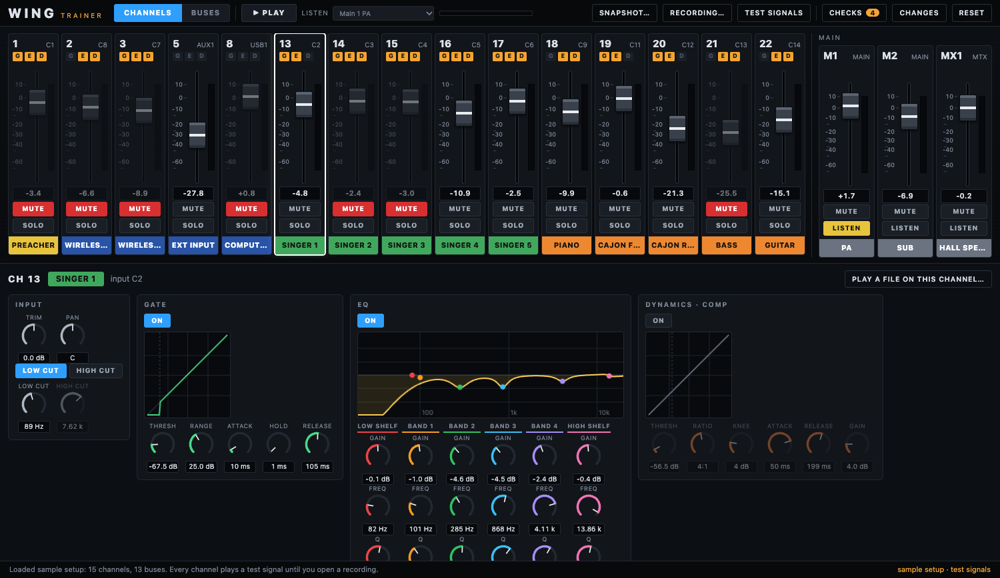
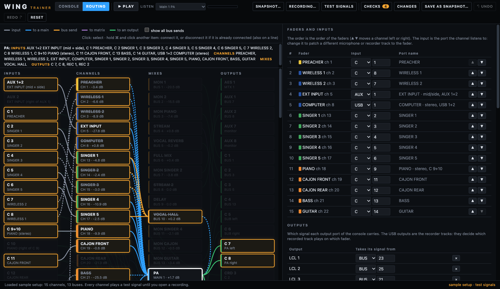

# WING Trainer

A practice console for a **Behringer WING** setup. Open a snapshot saved from the console and a recording of a service, and try the mix on a screen laid out like the console's (colour-coded channel strips with the name tag at the bottom, a fader with its dB scale and segmented meter, rotary knobs, and EQ, gate and compressor graphs): move faders, change the EQ, the gate and the compressor, build a monitor or stream mix, and hear what it does. Nothing is sent to a real console.



It is made for **testing the Sunday setup** before Sunday, and for practising without touching the console. It is a simulator, not the WING's own software, and its sound is close to the console's but not identical (see *What is simulated*).

## Documentation

The [`docs/`](docs/README.md) folder has a [user guide](docs/user-guide.md) (every control, the recording names, the Routing tab, checks and changes) and a description of [what is inside](docs/whats-inside.md) (the files, the audio graph, how a snapshot and a recording are read, the tests and releases).

## Run it

```bash
npm install
npm start          # builds, then opens the app
npm test           # unit tests of the snapshot reader, the checks and the rest
npm run e2e        # renders the sample setup offline and measures the sound (needs a display)
```

Node 22 or newer. The app starts with an **anonymised sample setup** (a preacher, two wireless microphones, five singers, piano, cajon, bass and guitar) playing test signals, so it works at once.

## Installers and releases

`npm run package` builds the installer for the computer you are on (into `release/`): a `.dmg` and a `.zip` on macOS, a setup `.exe` and a `.zip` on Windows, an `.AppImage` and a `.deb` on Linux. `npm run package:dir` makes just the unpacked app for a quick check.

To publish a release for all of them:

```bash
npm version patch          # or minor / major: bumps package.json and creates the tag vX.Y.Z
git push --follow-tags     # the tag starts .github/workflows/release.yml
```

The workflow builds the installers on macOS (Apple silicon and Intel), Windows and Linux, and attaches them to a GitHub release for the tag. **Run workflow** on the Actions tab builds them as downloadable files only, without a release. The builds are **not code-signed**, so the first start needs one extra step (the release notes say which). `.github/workflows/ci.yml` runs the types, the unit tests and the build on all three systems for every push, and the sound check under a virtual display on Linux.

## It remembers where you ended

The window opens **maximized** (and later where you left it), the **snapshot** you had open is opened again, and your **work** is back: edits, copied channels, the order of the faders, the selected channel, the open tab. The file dialogs open in the folder you used last, and an open recording is read again. Details in the [user guide](docs/user-guide.md#what-the-app-remembers).

## The Routing tab



**ROUTING** (next to CONSOLE at the top) shows how the whole venue is organised, drawn from the snapshot: the **input ports** (the stage box, the aux input, the USB and the player), the **channels**, the **mixes** (buses, mains, the matrix) and the **output ports** (stage box outputs, aux, the recorder tracks, AES/EBU). Click a channel, a mix or an output to light up its whole path, both ways: where its signal comes from and every output it reaches. Bus sends are drawn only for what you click, or all of them with **show all bus sends**.

The same tab lets you **remap** without a console:

- **Faders and inputs:** move a channel left or right (▲ ▼) to change the order of the faders, and change the **input** a channel listens to (the group and the port). When a recording is open, the tracks follow: give a channel another input and the track recorded on that input plays on it.
- **Outputs:** change what each output port carries, unpatch one (×) or patch a new one. The USB outputs are the recorder tracks, so changing them changes which recorded track plays on which fader.

You can also **copy a channel to a new input** (the button is on the selected channel's panel in the Console view): the whole strip is copied to a free channel number that listens to the input you choose.

It all works on the snapshot in the app, with nothing connected: the trainer never talks to a console. What you remap shows in **Changes** (and **Reset** undoes it), so you can repeat it on the real console.

## How to use it

1. **Open snapshot…** loads a `.snap` file saved by the console (JSON). Your own snapshot stays on your computer and is never copied anywhere; `*.snap` files are ignored by git.
2. **Open recording…** loads a folder of tracks from the console's **USB recorder** (multitrack). Name the files like `Track 03.wav`: the number is the recorder track. The snapshot says which input each recorder track took, and which channels are patched to that input, so every track lands on the right channel by itself. The app tells you what it placed and what it could not.
   - A single file can be played on any channel with **Play a file on this channel…** (for example a stereo mix on a playback channel).
   - Decoded audio takes a lot of memory: use an excerpt of two to ten minutes, and files up to 200 MB.
3. **Play** starts every channel together and loops them. **Listen to** chooses what the speakers get: a main, a bus (a monitor mix or the stream mix) or a matrix. **S** (solo) listens to that channel alone.
4. Click a channel to see its settings below: **input** (trim, pan, low and high cut), **gate** and **dynamics** with their curves, a six-band **EQ** with its response curve, and its **sends** (to the buses and the mains, pre or post fader). Turn a knob by dragging it up or down (hold Shift for fine steps), with the wheel or the arrow keys; double-click to put it back. **CHANNELS / BUSES** switches the strips between the channels and the buses; the mains and the matrix are always on the right (LISTEN plays one).
5. **Checks** lists trouble spots found from the settings (a gate that opens too fast, a compressor without make-up gain, a fader pushed up, a channel that goes nowhere). **Changes** lists everything you changed against the snapshot, in words, so you can make the same changes on the console (the trainer does not write snapshots). **Reset** goes back to the snapshot.

## What is simulated

| Console | Here |
|---|---|
| Input trim, low cut, high cut | yes |
| Six-band EQ (low and high shelf or bell, four bells) | yes, with standard filters |
| Gate (threshold, range, attack, hold, release) | yes |
| Compressor, the `COMP` model (threshold, ratio, knee, attack, release, make-up) | yes |
| Fader, mute, pan, solo | yes |
| Sends to buses (pre or post fader), assignment to mains, bus to matrix | yes |
| Other dynamics models (limiters, N-STR ...), effects (reverb, delay ...), bus EQ and dynamics, DCA groups, input preamps, the console's own layers and screens | **not yet**: shown, but the signal passes through |

The sound comes from the standard Web Audio filters and from the gate and compressor of [PreStreamer](https://github.com/AC-Dubnica/prestreamer)'s mixer. They behave like the console's but are not Behringer's algorithms, so use this to learn what a setting does and to compare settings, not to match the room to the decibel.

## How it is built

Electron and TypeScript, bundled with esbuild.

- `src/shared`: pure code, unit-tested. `snapshot.ts` reads a snapshot into the model in `model.ts`; `convert.ts` turns console values into audio parameters; `checks.ts` finds trouble spots; `diff.ts` lists changes; `multitrack.ts` places recorder tracks on channels.
- `src/renderer/engine.ts`: the audio graph (a Web Audio context that can also be an `OfflineAudioContext`, which is how `scripts/e2e-engine.mjs` measures it). `app.ts` is the screen.
- `fixtures/sample.snap.json`: the anonymised sample, cut down from a real snapshot (names changed, no serial number).

## Not in this version

Lessons with goals and hints, fault drills, effects, the console's layers and DCA groups, and other languages (English only for now). The look follows the WING's from memory and from its documentation, not from its own software, so colours and layout are close but not exact.
