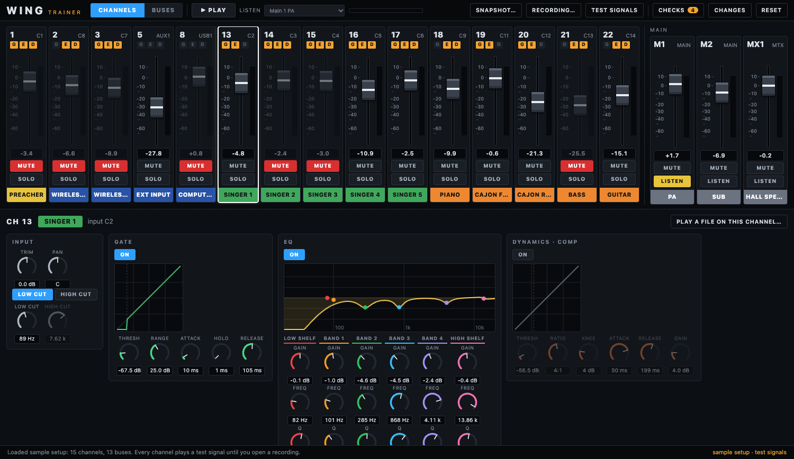
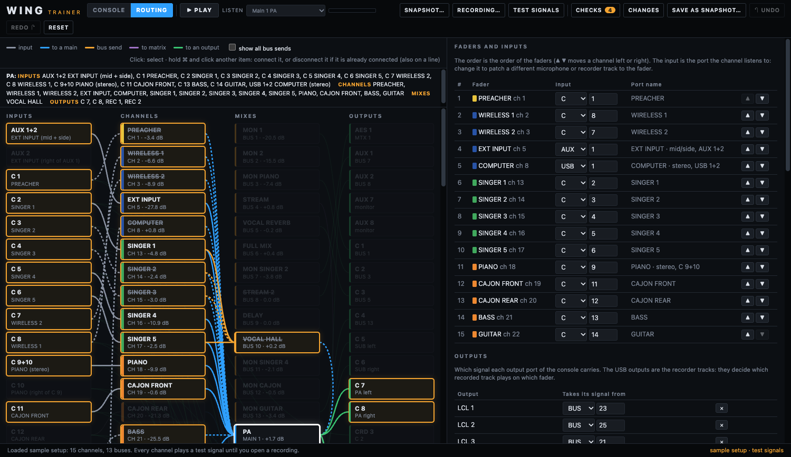

# WING Trainer: documentation

WING Trainer is a practice console for a Behringer WING setup. You open a snapshot saved from the console (and, if you have one, a recording of a service) and try the mix on a screen laid out like the console's. Nothing is connected to a console.

| Page | What is in it |
|---|---|
| [User guide](user-guide.md) | How to use the app: opening a snapshot and a recording, the Console tab, the Routing tab, checks, the list of changes, shortcuts, and what to do when something does not work. |
| [What is inside](whats-inside.md) | How the app is made: the folders and files, how a snapshot becomes a model, the audio graph, the Routing tab, how a recording is placed on the channels, the tests, and how releases are made. |

## At a glance

- **Open** a WING snapshot (`.snap`, JSON). The app starts with an anonymised sample setup so it works at once.
- **Play** the channels together: test signals, or a multitrack recording from the console's USB recorder.
- **Mix:** faders, mute, solo, pan, low and high cut, a six-band EQ, gate and compressor, sends to buses and mains.
- **Routing:** see the signal flow of the whole venue, light up the path of any channel, and remap inputs, outputs and the order of the faders.
- **Checks and Changes:** a list of trouble spots in the settings, and a list of everything you changed, in words.
- It is a **simulator**: its sound is close to the console's, not identical, and it never talks to a console. It can save your edits as a **new snapshot file** (never over the original) for you to load on the console; that has not been tried on a real console yet.

The README in the root of the repository has the short version and the commands to run and package the app.
