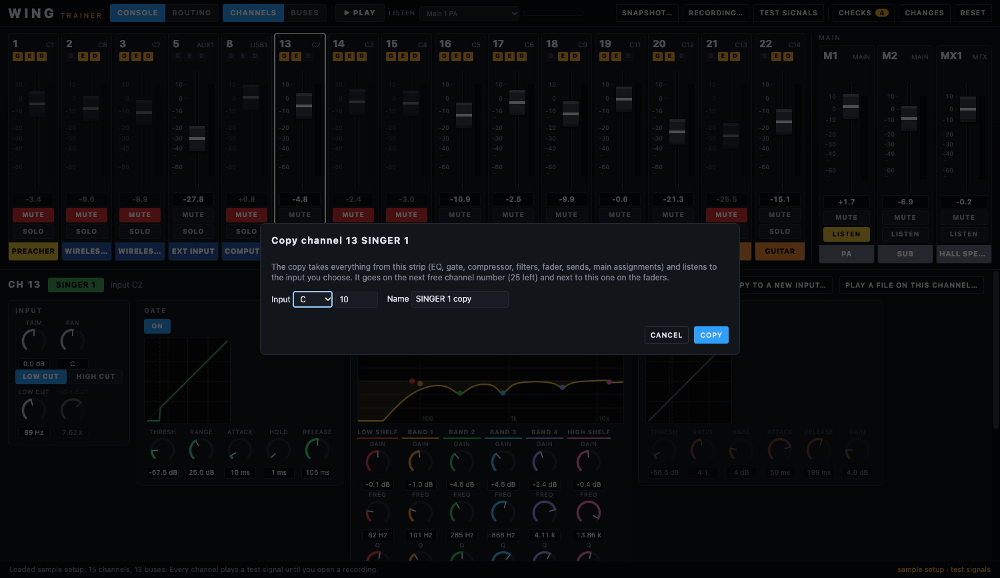
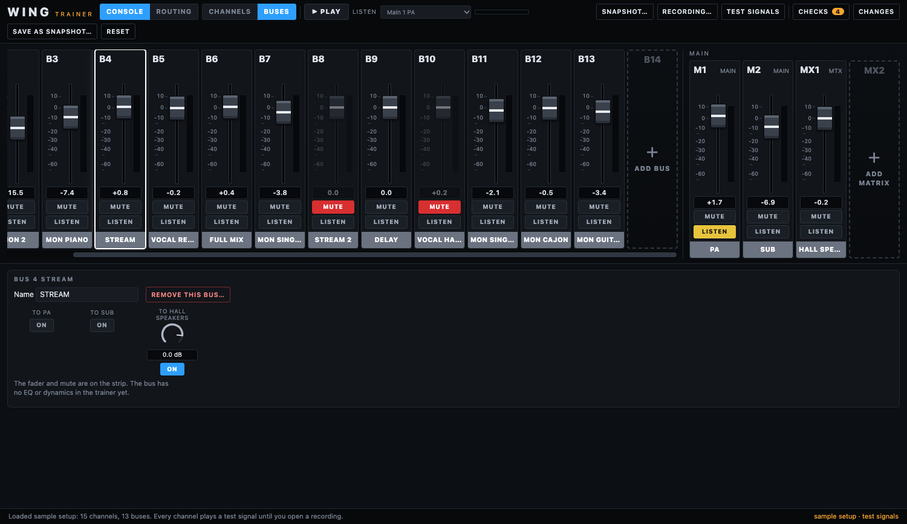

# User guide

[← Documentation](README.md)

## Start

Run the app (`npm start`, or install a release). It opens with an **anonymised sample setup**: a preacher, two wireless microphones, five singers, piano, cajon, bass and guitar, each playing a test signal. Press **PLAY** and you hear it.

The top bar:

| Control | What it does |
|---|---|
| **CONSOLE / ROUTING** | The two views of the app (see below). |
| **CHANNELS / BUSES** | In the Console view: which strips are shown on the left, the channels or the buses. |
| **PLAY / STOP** | Starts or stops every channel together (they loop). |
| **LISTEN** | What the speakers play: a main, a bus (a monitor mix, the stream mix) or a matrix. The small meter next to it shows its level. |
| **SNAPSHOT…** | Opens a snapshot file from the console. |
| **RECORDING…** | Opens a folder with a multitrack recording. |
| **TEST SIGNALS** | Goes back to a test signal on every channel. |
| **CHECKS** | Trouble spots found in the settings (the number is how many). |
| **CHANGES** | Everything you changed against the snapshot, in words (the number is how many). |
| **RESET** | Back to the snapshot as it was loaded. |

The bottom line says what was loaded, what a recording placed where, or why something failed. On the right it names the snapshot and whether test signals or a recording are playing.

## Open your own snapshot

1. On the console, save a snapshot to the USB stick (the file ends in `.snap`).
2. **SNAPSHOT…** and choose it. The app reads the channels, buses, mains, matrix, the input and output patching and the settings of every channel.
3. A snapshot from another firmware also opens: whatever the app does not know gets a neutral value.

Your snapshot stays on your computer. It holds the names of people and the console's serial number, so do not put it in a public repository (`*.snap` files are ignored by git here).

## Open a recording

**RECORDING…** takes a **folder** of tracks from the console's USB recorder, one file per track, named like `Track 03.wav` (or `03.wav`, `ch12.flac`): the last number in the name is the recorder track.

The snapshot says which input each recorder track took, and which channels listen to that input, so each track lands on the right channel by itself. The bottom line lists what was placed and what was not (for example a file with no number in its name, or a track nothing is patched to).

- **Play a file on one channel:** select the channel and press *Play a file on this channel…* (for example a stereo mix on a playback channel).
- **Size:** decoded audio takes a lot of memory. Use an excerpt of two to ten minutes and files up to 200 MB each.
- **Formats:** wav, flac, mp3, ogg, aiff, m4a.

## The Console view

**Strips.** Each channel has a strip like the console's: its number and input at the top (`13 C2`), small **G E D** lights that are lit when the gate, EQ and dynamics are on, a fader with a dB scale and a segmented meter, the level in dB, **MUTE** and **SOLO**, and the channel's name in its colour at the bottom. The numbers `G -25` and `C -6` above the fader are the gate and compressor working (dB of reduction) while playing.

- **Fader:** drag it. Its travel spends more of its length near 0 dB, like the console's. All the way down is off (-∞).
- **SOLO** plays that channel alone, whatever LISTEN says. **MUTE** silences it.
- Click a strip to select it; the panel below shows its settings.
- **Mains and matrix** (PA, SUB, HALL SPEAKERS in the sample) are always on the right. **LISTEN** on one plays it. A **main** is not a bus: PA and SUB are the console's mains (up to four). A **matrix** is an extra output mix fed by buses and mains: select the main or bus to switch on its send to the matrix, or ⌘-click the two in the Routing tab.
- **BUSES** shows the buses on the left instead of the channels: fader, mute and LISTEN, so you can hear a monitor mix.
- The mouse wheel scrolls the strips sideways when there are more than fit.

**Selected channel.** Below the strips, in sections:

- **Input:** trim, pan, and the low and high cut with their frequencies.
- **Gate:** on/off, a graph of its curve (the dashed line is the threshold), threshold, range, attack, hold, release.
- **EQ:** on/off, the frequency response curve with a dot for each of the six bands, and for each band gain, frequency and Q.
- **Dynamics:** on/off, the compressor's curve, threshold, ratio, knee, attack, release and make-up gain. Only the `COMP` model is simulated; for the others (limiters, N-STR) it says so and the signal passes.
- **Sends:** whether the channel goes to each main and each bus, how much, and whether the tap is before the fader (PRE) or after it (POST).

**Knobs.** Drag a knob up or down to turn it (hold **Shift** for fine steps), or use the mouse wheel, or click it and use the arrow keys. **Double-click** puts it back to the value it had when the snapshot was loaded. A greyed knob belongs to a section that is switched off.

**Copy a channel to a new input.** With a channel selected, **COPY TO A NEW INPUT…** (top right of its panel) makes a copy of the whole strip: EQ, gate, compressor, filters, trim, fader, pan, mute, the sends to buses and the assignments to mains. You choose the input the copy listens to (a group such as `C` and a port; the app suggests the next port nobody uses) and its name. The copy takes the lowest free channel number (the console has 40) and stands next to the original on the faders. It is independent: changing it does not change the original. If a recording is open, the track recorded on that input plays on the copy. The copy shows in **CHANGES** (`Ch 4 SINGER 1 copy: Added - -> copy of Ch 13, input C 10`) and **RESET** removes it.



## Stereo channels

A channel can listen to a **stereo pair** of input ports instead of one mono port (the piano on `C 9` and `C 10` in the sample, a computer on `USB 1` and `USB 2`, a player). The snapshot says so in the mode of the input port (`ST`), and the trainer shows it:

- **On the strip:** the input reads `C9+10` and a blue **ST** mark is next to the G E D lights. A mid and side pair (the external input in the sample, `AUX 1+2`) is marked **M/S**.
- **In the channel's panel:** the line next to the name says `input C9 + 10, stereo (left and right)`.
- **In the Routing tab:** the input node reads `C 9+10 (stereo)`; the second port, `C 10`, is shown as "right of C 9" (the recorder takes it as a track of its own). In the table the channel's row says `stereo, C 9+10`.
- **In the sound:** the channel keeps two sides all the way: the filters, EQ, gate and compressor work on both (the gate and compressor detect on the louder side), **PAN** is a balance, and the sends and the mains get both sides. A mid/side pair is decoded (left = mid + side, right = mid − side). Without a recording the channel plays a stereo test signal.
- **With a recording:** a stereo channel plays **two tracks**: the track of its input is the left side and the track of the next port is the right side (for the piano, recorder tracks 7 and 8). Name the files `Track 07.wav` and `Track 08.wav` as usual. If only one of them is there, it plays on both sides.
- **Changing the input:** give a channel an input that is a stereo pair (in the Routing tab) and it becomes stereo; give it a mono one and it becomes mono again. The saved snapshot only holds the input port: the console decides stereo from the port's mode.

Not simulated: the stereo **width** of a channel (it is read but not applied).

## Mains are stereo: the PA is C 7 and C 8

A main is a **stereo pair**, a left and a right. In the output patch the source group **MAIN** therefore lists the sides, not the mains: `MAIN 1` is the **left** of main 1, `MAIN 2` its **right**, `MAIN 3` the left of main 2, `MAIN 4` its right, and so on. In the sample, `C 7 <- MAIN 1` and `C 8 <- MAIN 2` are the **left and right of the PA** (main 1), and `C 5` and `C 6` are the left and right of **SUB** (main 2). The recorder tracks `REC 1` and `REC 2` are the PA's left and right too.

The trainer shows it that way: in the Routing tab the PA has a line to `C 7` (marked **L**) and one to `C 8` (marked **R**), the output nodes say `PA left` and `PA right`, the Outputs table writes `PA left` beside a MAIN source, and Changes says `MAIN 1 (PA left)`. (The WING Quick Start Guide describes it as selecting MAIN and assigning `1L` to output 7 and `1R` to output 8.)

**Connecting a main to an output** with ⌘-click patches the **left side to an odd port** and the **right side to an even port** (C 7 gets the PA's left, C 8 its right); connect the PA to the other port as well to get both sides. A mono main is one entry. The sound is not affected (outputs are not simulated, mains are heard as a stereo pair).

## Buses and matrices: add, rename, remove

Press **BUSES** (next to CHANNELS) to see the buses. The console has 16 buses and 8 matrices; the sample uses 13 and 1.

- **Add:** the **empty strip at the end of the buses** (dashed, named with the next free number, say `B14`, with **ADD BUS** on it), and the same at the end of the matrices (**ADD MATRIX**), open a small dialog for the name. The new bus or matrix takes the lowest free number. **Nothing is sent to it yet:** every channel's send to a new bus is off, and it goes to no main and no matrix. Switch on the sends of the channels that should feed it (the *Sends* section of a channel, or the Routing tab), or, for a matrix, the send of a bus to it (select the bus).
- **Rename:** select a bus or matrix strip and change the **Name** box in the panel below (at most 16 characters).
- **Remove:** **REMOVE THIS BUS…** (or matrix) asks first and says how many channels send to it and how many output ports carry it. Removing it switches those sends off and unpatches those outputs. **RESET** brings it back.
- All of it shows in **CHANGES** (`Bus 14 MON SINGER 6: Added`, `Bus 4 STREAM: Name STREAM -> WEB STREAM`, `Bus 9 DELAY: Removed`).
- The mains (PA, SUB) cannot be added or removed: there are four on the console and they are fixed here.



## The Routing view

**ROUTING** shows how the whole venue is organised, drawn from the snapshot. Four columns, left to right:

1. **Inputs:** the input ports that are used (stage box, the aux input, USB, the player), with the name the snapshot gives each port.
2. **Channels,** in fader order.
3. **Mixes:** buses, mains and the matrix.
4. **Outputs:** the patched output ports (stage box outputs, aux, the USB and card recorder tracks, AES/EBU, the recorder).

The lines show the signal: blue to a main, amber a bus send, purple to a matrix, green to an output, grey from an input. A dashed line is a muted channel or bus.

**Follow a signal.** Click any item: its whole path lights up, both ways (where the signal comes from, and every output it reaches). The item you clicked has a **white** outline, every other input, channel (fader), mix and output on its path an **amber** outline, and everything else fades. A line above the diagram lists the path in words, by column (inputs, channels, mixes, outputs). Click the item again to clear. Bus sends are drawn only for the clicked path, or all of them with **show all bus sends**.

**Make and remove connections in the diagram.** Select an item with a click, then:

- **Hold ⌘ and click another item** (Ctrl on Windows and Linux). If the two are **not connected, they get connected**; if they **already are, the connection is removed**. You can name them in either order.
- **Hold ⌘ and click a line** to remove that connection.

While you hold the key the cursor becomes a crosshair, and the line at the bottom says what happened (or why it was refused).

| Select | ⌘-click | What happens (⌘-click again: it is removed) |
|---|---|---|
| an input port | a channel | the channel now takes that input |
| a channel | a main | the channel is assigned to the main |
| a channel | a bus | the channel sends to the bus (at 0 dB, turn it down with its knob in the channel's Sends) |
| a bus | a main | the bus is assigned to the main |
| a bus **or a main** | a matrix | the bus (or main) sends to the matrix |
| a main, bus or matrix | an output port | the output carries it (replacing what it carried) |
| an input port | an output port | the input is passed straight to the output (the recorder tracks) |

**Replacing asks first.** If a connection would take another one away, a dialog says so and asks: an output that carries something else (for example `AUX 2` carries bus `STREAM 2` and you connect a matrix to it) or a channel that already listens to another input. **CANCEL** (the default) changes nothing; **REPLACE** goes ahead. The same question is asked when **PATCH** in the Outputs table would replace what a port carries. Connections that only add (a send, a main assignment) are made at once, and so is a change of the source in a row of the Outputs table, which is a deliberate edit of that row.

A send that is all the way down counts as not connected, so ⌘-click turns it on. Things of the same kind (two channels) are refused with a message. Every input port that has a name in the snapshot is in the diagram, used or not, so a channel can be connected to it. To patch an output port that is not shown (nothing is patched to it), use **PATCH** in the Outputs table.

**Remap, without a console.** The two tables on the right change the routing in the app:

- **Both tables keep their place** when you change something: they do not jump back to the top.
- **Faders and inputs:** the ▲ ▼ buttons move a channel to the left or right in the order of the faders. The **Input** boxes change which port the channel listens to (a group such as `C`, `AUX`, `USB`, and a port number). With a recording open, the tracks follow at once: a channel that now listens to another input plays the track recorded on that input.
- **Outputs:** each patched output port shows its source (a main, matrix, bus, the console monitor, or an input passed straight through). Change it, unpatch it with ×, or patch another port at the bottom with **PATCH**. The USB outputs are the recorder tracks, so changing them changes which recorded track plays on which fader.

The order of the faders is a trainer feature: it is not the console's own layer setting.

## Undo and redo

**⌘Z** (Ctrl+Z on Windows and Linux) **undoes** your last change and **⌘⇧Z** (Ctrl+Shift+Z, or Ctrl+Y) **redoes** it, as many steps as you like. The **↶ UNDO** and **REDO ↷** buttons in the top bar do the same and show when there is something to undo or redo. The bottom line says what was undone, for example `Undone: Ch 14 SINGER 2: Mute off -> on`.

- **A step** is one change: dragging a knob or a fader is one step (it settles half a second after the last move), not hundreds.
- **What is covered:** everything that changes the snapshot: faders, knobs, mutes, sends, copied channels, added and removed buses and matrices, connections and the output patch, the order of the faders, **RESET**.
- **Not covered:** which channel is selected, which tab is open, loading a snapshot or a recording. Opening another snapshot starts a new history.
- **A new change** after an undo ends the redo (the steps you took back are gone), as in any editor.
- **Text boxes** (a name, a port number) keep their own undo while you are typing in them: ⌘Z there undoes the typing. The shortcut does nothing while a dialog is open.
- The history lasts while the app is open (200 steps). What you did is still remembered between runs, but not the steps to undo it.

## Checks and Changes

**CHECKS** lists trouble spots the settings suggest. They are hints, not verdicts:

- a gate with an attack under 5 ms (it can click on a voice),
- a compressor without make-up gain (the channel gets quieter when it works),
- a fader above +5 dB (raise the gain at the source instead) or very low,
- a channel that goes nowhere (no main, no bus),
- a muted channel with pre-fader sends on.

**CHANGES** lists everything that differs from the snapshot, one line each, for example:

```
Ch 13 SINGER 1: Gate attack 10 ms -> 20 ms
Ch 13 SINGER 1: Input C 2 -> C 5
Output C 7: Source MAIN 1 -> MAIN 2
Fader order: PREACHER, SINGER 1, WIRELESS 1, ...
```

**COPY** puts the list on the clipboard. To use a result, repeat the changes on the console, or save them as a new snapshot file (next section). **RESET** goes back to the snapshot.

## Save as a snapshot

**SAVE AS SNAPSHOT…** in the top bar makes a **new snapshot file** from your own snapshot with your edits written in. (It needs a snapshot you opened with SNAPSHOT…: the built-in sample is a cut-down copy and cannot be saved.)

1. Press **SAVE AS SNAPSHOT…**. The dialog says how many changes will be written.
2. **SAVE AS…** asks where to put the file; the name suggested is `<your file> (edited).snap`. The original file is **never overwritten**: choosing its name is refused.
3. Beside it, `<name>.changes.txt` lists the changes in words.
4. Put the file on a USB stick (or open it in WING-Edit) and load it on the console like any snapshot.

**What is written.** Only the values that differ from the snapshot as you opened it, in the file's own names and units:

- channels: name, input, trim, fader, mute, pan, low and high cut, the six EQ bands (and shelf or bell), the gate, the compressor (on, threshold, ratio, knee, attack, release, make-up), the sends to buses (level, on, pre or post) and the assignments to mains;
- **copied channels:** the copy gets the original's whole strip in a free channel slot, then what you changed on it;
- **buses and matrices:** added (name, fader, mute, assignments), renamed, removed (the slot is emptied, the sends to it switched off), fader, mute, sends to matrices;
- the mains' fader and mute, and the **output patch** (including the recorder tracks).

**What stays as it was.** Everything else in the file: effects, DCA groups, the console's layers, preamps and input port names, the routing of the effects, the settings. The **order of the faders** is not written (it is a trainer feature, not the console's layer setting).

**Not tried on a real console.** The file keeps the console's own structure and only changes values, and a test reads an exported file back and finds exactly what was edited, but I could not load one on a WING. Load it into a **spare snapshot slot** first, check the channels and the routing, and keep your original.

It is a good idea to try it first with a small change: one fader or one gate attack.

## What the app remembers

The app opens where you left it:

- **The window:** it opens **maximized** the first time. After that it comes back in the size and place you left it, and maximized again if you closed it maximized. A window left on a screen that has been unplugged is moved back onto a screen.
- **The snapshot:** the file you had open is opened again by itself (read from the file, so a changed file shows its new content). If the file is gone, the sample opens.
- **Your work:** your edits (faders, knobs, copied channels, remapped inputs and outputs), the order of the faders, the selected channel, the open tab (Console or Routing), CHANNELS or BUSES, and what you listen to. The bottom line says "Back where you left off" and how many changes you have. **RESET** still goes back to the snapshot as it was loaded.
- **The recording:** the folder you opened is opened again and its tracks are read again (this can take a moment for a large recording). If the folder has gone, the channels play test signals. A file played on a single channel is not remembered.
- **The folders of the dialogs:** the snapshot, recording and audio file dialogs open in the folder you used last time.

All of it is kept in `session.json` in the app's data folder (on macOS `~/Library/Application Support/wing-trainer`, on Windows `%APPDATA%\wing-trainer`, on Linux `~/.config/wing-trainer`). Delete that file to start fresh.

## Good to know

- The sound is a **simulation**. The EQ uses standard filters; the gate and compressor behave like the console's but are not Behringer's algorithms. Use it to learn what a setting does and to compare settings, not to match a room to the decibel.
- **Not simulated yet:** effects (reverb, delay and so on), the bus EQ and dynamics, DCA groups, the preamp, the console's own layers and screens. These are shown or ignored; the signal passes through.
- Muting a channel silences it everywhere (the real console may keep pre-fader sends alive).
- The preamp gain and phantom power in the snapshot are read but do not change the sound.

## When something does not work

| What you see | What to do |
|---|---|
| "This is not a WING snapshot" | The file has no channels. Choose the `.snap` file the console saved. |
| "None of the N files could be placed" | Name the tracks `Track 01.wav`, `Track 02.wav`... (the number is the recorder track) and check that the snapshot patches that USB track to an input. |
| A channel is silent | Is it muted (red MUTE)? Is its fader down? Does it have an input (the strip says `no input`)? Is it sent to a main, or is LISTEN set to something else? |
| "This file is too large" | Cut a shorter excerpt (under 200 MB). |
| No sound at all | Press PLAY (the app plays nothing until then) and check LISTEN and the computer's output device. |
